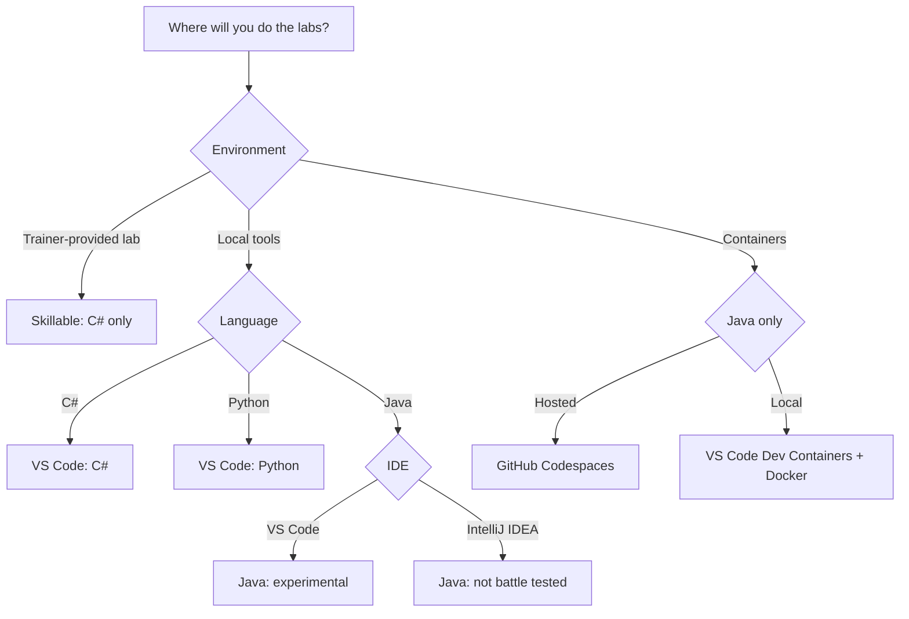

# AZ-2007 lab guide

Choose your environment, then follow the **ordered lab links for your option**. You use your own GitHub account and GitHub Copilot access.

This repository is a navigation guide, **not the lab application repository**. Original setup and exercise instructions stay in their source repositories. The only locally written exercise instructions are the explicitly experimental IntelliJ adaptations.

## Choose your route

Use the links below; you do not need to interact with the diagram.

| Option | Language | What to expect |
| --- | --- | --- |
| [Skillable](docs/setup/skillable.md) | C# only | Fully guided. Your trainer will provide you with a lab key and instructions on how to log in. |
| [Your computer + VS Code: C#](docs/setup/local-csharp.md) | C# | Microsoft exercises; local .NET toolchain. |
| [Your computer + VS Code: Python](docs/setup/local-python.md) | Python | Microsoft Python variants; local Python toolchain. |
| [Your computer + VS Code: Java](docs/setup/local-java-vscode.md) | Java | Experimental community adaptation; local Java/Maven toolchain. |
| [Your computer + IntelliJ IDEA: Java](docs/setup/local-java-intellij.md) | Java | Locally adapted instructions grounded in official documentation; **not battle tested**. |
| [GitHub Codespaces: Java](docs/setup/codespaces-java.md) | Java only | Upstream Java development container hosted by GitHub; experimental labs. Usage limits/billing apply. |
| [Local Dev Containers: Java](docs/setup/devcontainers-java.md) | Java only | The same upstream container, using VS Code's Dev Containers extension and local Docker; experimental labs. |

Already ready? Each option page includes its prerequisite reminders and lab links in the correct order. Do not follow every entry in the mixed upstream catalog.

## Which exercises apply?

| Track | Exercises to follow | Details |
| --- | --- | --- |
| [C#](docs/tracks/csharp.md) | 01-16, using the C# variants | Includes the additional .NET applications and specialized prerequisites. Skillable's assigned sequence takes precedence. |
| [Python](docs/tracks/python.md) | Shared 01, Python 02-05, shared 06 | The unit-testing variant is **pytest**, not xUnit. |
| [Java](docs/tracks/java.md) | Java-source 01-06 | VS Code, Codespaces, and Dev Containers use upstream instructions; IntelliJ has separate adaptations. |

- **06 is a web prototype exercise** using HTML, CSS, and JavaScript, not a C#/Python/Java application exercise.
- **07-16 use C#/.NET applications**; no Python or Java variants are supplied by the linked sources. They are omitted from those routes.
- Python in the prerequisites of **13-14** runs Spec Kit tooling; those are still **C# labs**.
- The hosted and local container options here are **Java-only**. They do not imply C#/Python container support.

## Sources and validation

- [Microsoft exercise website](https://microsoftlearning.github.io/mslearn-github-copilot-dev/) - learner-friendly instructions.
- [Microsoft source labs](https://github.com/MicrosoftLearning/mslearn-github-copilot-dev/tree/main/Instructions/Labs) - the same catalog in Markdown. On 2026-10-28, all **25 document filenames matched** the published website; [the index is generated from the lab folder](https://github.com/MicrosoftLearning/mslearn-github-copilot-dev/blob/main/index.md).
- [Java adaptation](https://github.com/mkennten/mslearn-github-copilot-dev-java) - community-maintained Java exercises and sample project; not an official Microsoft Java track.
- [IntelliJ sources, feature boundaries, and attribution](docs/intellij/SOURCES.md).

Links and language applicability have been checked against the sources. The Java container configurations have been inspected, **not built or walked through here**. The IntelliJ adaptations have been checked against official documentation, **not tested in IntelliJ**. Upstream instructions and IDE features can change; follow current prerequisites and your trainer's directions.
